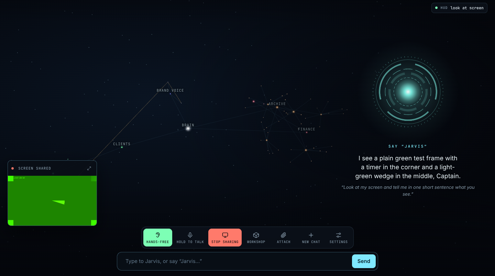
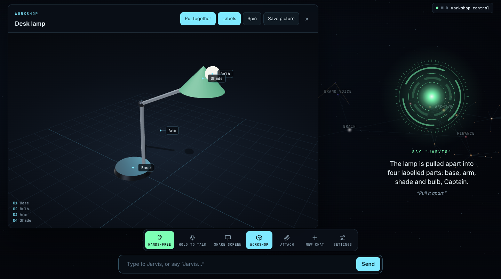
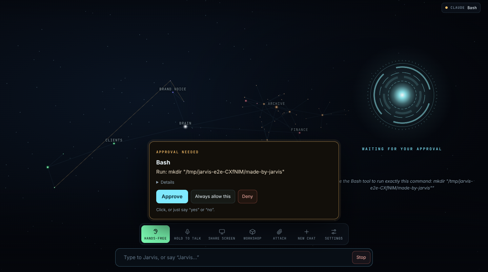

# JARVIS — Claude edition

A voice assistant HUD that runs on your own computer and thinks with **your Claude Code** — same login,
same connectors (Gmail, Calendar, Drive…), same skills, memory and CLAUDE.md files. ElevenLabs gives it
a voice. It can see your screen when you share it, pull up your files in a 3D "second brain" galaxy,
and build 3D models in a workshop.



Nothing here calls a model API directly and there is no Anthropic API key to manage: the brain is the
`claude` program already on your machine.

## Start it (3 steps)

**You need:** [Node.js 18+](https://nodejs.org) · [Claude Code](https://claude.com/claude-code), logged in
(run `claude` once in a terminal) · Google Chrome or Edge · an ElevenLabs API key.

1. **Start** — double-click `start.command` (Mac) or `start.bat` (Windows). Or in a terminal:

   ```bash
   node server.mjs
   ```

2. **Click Start** in the browser tab that opens (`http://localhost:4747`) and allow the microphone.
3. **Settings opens by itself the first time** — paste your ElevenLabs key, pick a voice, press
   **Test voice**, tell Jarvis what to call you, and point it at your second-brain folder. Save.

No `npm install`: the app has zero dependencies. To check the machine before starting:

```bash
node server.mjs --doctor
```

**ElevenLabs key:** create it at elevenlabs.io → Developers → API Keys. If you restrict the key, it needs
Text to Speech, Speech to Text and Voices (read). The key is written to `jarvis/.env` on this computer
(owner-only, git-ignored) and is sent only to ElevenLabs. Until a key is saved Jarvis still talks, using
the browser's built-in voice.

## Using it

| You say or do | What happens |
|---|---|
| "**Jarvis**, what's on my calendar tomorrow?" | Uses your Claude connectors. A chip top-right shows each tool as it runs. |
| "Jarvis, draft a reply to the last email from Sam." | Drafts it and shows it on screen. It does not send. |
| "Jarvis, pull up my brand voice files." | Finds them and lights them up in the galaxy, with a list you can click. |
| Press **Share screen**, then "Jarvis, look at this — what am I missing?" | Takes a fresh look at your screen and answers. "Where do I click to…" puts a pointer on the preview. |
| "Jarvis, open the workshop" / "build me a…" / drop a sketch or floor plan on the window | Builds a 3D model from named parts. "Pull it apart", "make the ring red", "put it back together". |
| "Jarvis, switch your brain to Opus." | Changes the Claude model. |
| "Jarvis, stop." · **Esc** · click the orb | Stops talking and stops the task. |
| "Jarvis, …" while it is busy | Drops the current task and does the new thing. |

Other ways in: **hold Space** (or the Hold-to-talk button) to speak without the wake word — this uses
ElevenLabs transcription and is the most accurate; or just type. `H` toggles hands-free, `/` jumps to the
text box. Drag any file or image onto the window to hand it to Jarvis.

**Conversation mode:** when Jarvis ends on a question ("Shall I add it to your calendar?") you can answer
without saying the wake word for a few seconds. Turn it off in Settings if you prefer.



## What it will and won't do on its own

Jarvis runs through an approval gate that this app enforces, not the model:

- **Runs without asking:** reading and searching (email, calendar, files, web), and its own HUD tools.
- **Asks first** (click, or say "yes"): anything that changes something — creating a draft or event,
  editing a file outside its workspace, running a command. "Always allow this" remembers your answer.
- **Always asks, every time** (click, or say "Jarvis, approve"): anything that **sends, publishes, pays,
  deletes, shares or pushes**. These can never be pre-approved.

"Reset approvals" in Settings forgets every "always allow".



## Where this came from, and what is different

This is a ground-up rebuild modelled on Zubair Trabzada's JARVIS videos (AI Workshop), mainly
["Fable 5.2 Just Took My JARVIS to a Whole New Level"](https://youtu.be/34J8xhaAn4U). His finished build
(v8.2) and prompt pack are only available inside his Skool community; none of his code is public, and
none is used here. His public repos that relate are
[`brain-map`](https://github.com/zubair-trabzada/brain-map) (a 2D note graph) and
[`holo-gestures`](https://github.com/zubair-trabzada/holo-gestures) (hand-gesture control).

| In his videos | Here |
|---|---|
| Brain: Anthropic API key (pay per use) | Brain: your Claude Code login — no API key |
| Voice: ElevenLabs | Voice: ElevenLabs (browser voice as fallback) |
| Hearing: Chrome speech recognition | Same for the wake word; ElevenLabs transcription for hold-to-talk |
| 3D galaxy of your files | Yes — own implementation |
| Tools: Gmail, Calendar, Canva… | Whatever connectors, skills and MCP servers your Claude Code has |
| Share screen, "look at this", pointing | Yes |
| Takes over the screen and clicks | **Experimental** — tick "Let Jarvis control Chrome" (needs the Claude in Chrome extension). Not tested as part of this build. |
| 3D workshop: build, pull apart, edit by voice | Yes |
| Photoreal render (he uses an OpenAI image model) | Not built in. Jarvis can save a snapshot and use an image connector if you have one connected. |
| Phone calls, Telegram, local offline brain, hand gestures | Not included |

## Good to know

- **Speed.** Every request is a full Claude Code turn with all your connectors loaded, so the first words
  usually take a few seconds — slower than a purpose-built voice bot. Set *Thinking effort* to Low, or the
  brain to Sonnet or Haiku, for snappier replies.
- **Usage.** Jarvis uses Claude Code in headless mode under your subscription; the usage chip top-right
  shows how much of your current window is used. Anthropic's rules for how headless usage is counted
  changed during 2026 — check your plan's current terms if you lean on it heavily. ElevenLabs bills per
  character spoken.
- **Privacy.** The server only listens on this computer (`127.0.0.1`) and rejects requests from other
  sites. Screen frames are held in memory and sent to Claude only when Jarvis looks. The wake word uses
  your browser's speech recognition (in Chrome that is a Google service). Your second-brain folder is
  read locally; file contents go to Claude only when Jarvis reads one to answer you.
- **Keep the tab open.** The browser tab is Jarvis's ears, voice and eyes. It keeps working in the
  background while you use other apps; giving it its own window works best.
- **Connectors.** The list in Settings appears after the first message. If an app you use in Claude is
  missing, open a terminal, run `claude`, type `/mcp` and connect it there — Jarvis picks it up on
  Reconnect. Some Claude Code versions have had bugs attaching claude.ai connectors in headless mode;
  `claude update` is the fix.

## If something isn't working

| Symptom | Fix |
|---|---|
| "Claude Code was not found" | Install Claude Code, run `claude` once to log in, press **Reconnect**. If it is installed somewhere unusual, set `CLAUDE_BIN=/full/path/to/claude` in `.env`. |
| "Claude Code is not logged in" | Run `claude` in a terminal, finish the login, press **Reconnect**. |
| "Your Claude Code is too old" | Run `claude update`, then **Reconnect**. |
| No sound | Click anywhere in the page once (browsers block audio until you do). Check the voice chip top-right. |
| "ElevenLabs rejected the API key" / credits used up | Fix the key or plan in Settings; Jarvis uses the browser voice meanwhile. |
| Wake word not heard | Use Chrome or Edge, allow the microphone (lock icon in the address bar), make sure Hands-free is lit. Hold-to-talk works in any browser. |
| It hears itself | Use headphones, or lower the speaker volume; echoes of its own words are filtered but loud speakers can beat the filter. |
| Port already in use | Jarvis is already running — open `http://localhost:4747`. To change the port set `JARVIS_PORT` in `.env`. |

## How it works

```
 Browser HUD (public/)                     server.mjs (127.0.0.1)                    your machine
 ───────────────────────                   ───────────────────────                  ─────────────────────────
 wake word / hold-to-talk  ── text ──▶     lib/brain.mjs  ── stream-json ──▶        claude  (Claude Code, headless)
 orb, captions, galaxy     ◀─ events ──    lib/mcp.mjs    ◀── tool calls ───           ├─ your connectors, skills, memory
 screen frames, 3D bench   ◀─ requests ──  lib/policy.mjs (approval gate)              └─ jarvis tools: look_at_screen,
 audio  ◀── MP3 stream ──                  lib/voice.mjs  ──▶ api.elevenlabs.io           show_panel, brain_focus, workshop_*
```

- `server.mjs` — local web server, event stream to the HUD, speech queue, settings, uploads.
- `lib/brain.mjs` — keeps one Claude Code process alive in streaming mode; resume, interrupt, restart.
- `lib/mcp.mjs` — the small tool server Claude calls for HUD abilities and for approval.
- `lib/policy.mjs` — decides allow / ask / always-ask.
- `lib/voice.mjs` — ElevenLabs speech and transcription; turns streaming text into speakable sentences.
- `lib/vault.mjs` — scans the second-brain folder into the galaxy graph.
- `persona.md` — Jarvis's instructions. Edit it to change how it talks and behaves.
- `public/` — the HUD. `vendor/` holds three.js (MIT licence) so the app works without a CDN.

## Tests

```bash
node --test test/unit.mjs
```

```bash
node test/live-protocol.mjs
```

```bash
node test/e2e.mjs
```

`unit` is offline. `live-protocol` drives your real Claude Code (uses a little usage) to prove streaming,
screen images, the approval gate and interrupt. `e2e` runs the whole app in headless Chrome against real
Claude with a stand-in for ElevenLabs; it needs Playwright, which Jarvis itself does not.
