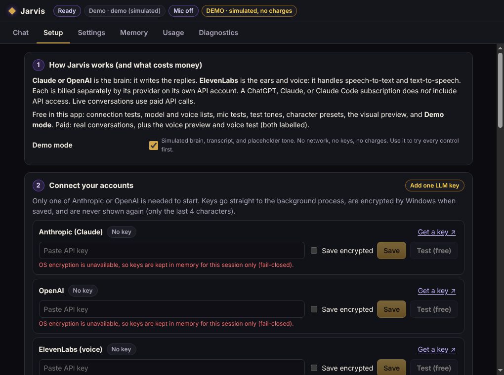
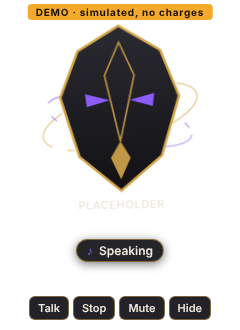
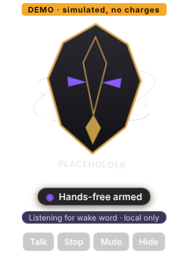

# Jarvis: desktop voice companion

A Windows desktop voice companion: talk naturally, hear an ElevenLabs voice answer, and see an original falcon-guardian character float at the edge of your desktop.

- **Brain:** Claude through the Anthropic API (default), or OpenAI through the Responses API, chosen in settings. One provider per turn.
- **Ears and voice:** ElevenLabs realtime speech-to-text (`scribe_v2_realtime`) and streaming text-to-speech (raw PCM, default `eleven_flash_v2_5`).
- **Character:** a transparent overlay with code-driven Orbit, Drift, or Still motion. The glow follows real mic input while listening and real played audio while speaking.
- **Activation:** click-to-talk, hold-to-talk, a global hotkey, or optional local "Hey Jarvis" (openWakeWord runs on your PC).
- **Memory:** in-RAM conversation by default, opt-in saved history, and explicit editable memories ("Remember that…").
- **Out of scope for v1, with no permissions or buttons for them:** camera, vision, screen capture, browser or computer control, shell, messaging, calls, email, calendar, CRM, invoices, file indexing, knowledge graph.

This is an independent build inspired by two public YouTube demos. It has no code from, and no affiliation with, their creator.

| | |
|---|---|
|  |   |

*Screenshots come from the automated smoke test in **Demo mode** on Linux/Xvfb, with the labeled placeholder character. Import your PNG in Setup → step 5.*

## Quick start (Windows)

Non-technical, step-by-step version: **[SETUP_WINDOWS.md](SETUP_WINDOWS.md)**.

Requires Node.js 22.12 or newer.

```bat
cd jarvis
npm ci
npm run dev
```

Build a portable app (`release\Jarvis-0.1.0-portable.exe`). No admin rights are needed to run it:

```bat
npm run package:win:portable
```

Build the portable app plus a per-user installer:

```bat
npm run package:win
```

**Try everything free first:** turn on **Demo mode** in Setup → step 1. The brain, transcript, and voice are simulated locally. No keys, no network, no charges.

## Scripts

| Command | What it does |
|---|---|
| `npm run dev` | Run with hot reload (dev CSP relaxed for Vite only) |
| `npm run build` | Production build into `out/` |
| `npm start` | Run the production build |
| `npm run typecheck` | TypeScript, main and renderer |
| `npm run lint` | ESLint |
| `npm test` | 93 deterministic tests (mocked transports, fake audio clock, no network) |
| `npm run check` | typecheck + lint + test + build |
| `npm run package:win:portable` / `package:win` / `package:win:dir` | Windows packaging (unsigned) |

## Versions (pinned in `package-lock.json`)

Electron 45.2.1 · electron-vite 6.0.0 · Vite 8.3.5 · React 19.3.1 · TypeScript 6.0.3 · zod 4.6.7 · ws 8.22.1 · Vitest 5.0.5 · ESLint 10.14.0 · electron-builder 26.18.0. Runtime dependencies are only `ws` and `zod`.

Wake-word helper (optional): openWakeWord 0.6.0 + onnxruntime 1.31.1, pinned in `wakeword/requirements.txt`.

## Where your data lives (Windows)

`%APPDATA%\Jarvis\`, which contains:

- `settings.json`: non-secret settings.
- `credentials.enc.json`: API keys, encrypted with Windows DPAPI via Electron safeStorage.
- `memories.json`: saved memories, plaintext.
- `history.json`: only if you turn on saved history; plaintext.
- `usage.json`: daily counters, no content.
- `assets\`: your imported character.
- `logs\jarvis.log`: redacted event codes only.
- `wakeword-venv\`: only if you set up hands-free.

**Uninstall:** delete the portable `.exe`, or uninstall from Windows Settings → Apps for the installer build. Then delete `%APPDATA%\Jarvis` to remove all data and keys.

## Build status (honest)

- **Unsigned.** There's no code-signing certificate. A copy you build yourself normally runs without a SmartScreen prompt. A downloaded copy may trigger a Windows warning.
- **Verified here (Linux cloud container):** typecheck, lint, 93 unit/integration tests, production build, a 24-check end-to-end Electron smoke test (Demo mode, fake microphone, real Web Audio playback, real openWakeWord helper), and a Windows portable cross-build.
- **Not yet verified:** anything needing your Windows PC, microphone, speakers, or paid API keys. See [TEST_REPORT.md](TEST_REPORT.md) for the exact remaining checks.

## Docs

[SETUP_WINDOWS.md](SETUP_WINDOWS.md) · [CUSTOMIZATION.md](CUSTOMIZATION.md) · [ARCHITECTURE.md](ARCHITECTURE.md) · [PRIVACY.md](PRIVACY.md) · [TEST_REPORT.md](TEST_REPORT.md) · [CLAUDE_HANDOFF.md](CLAUDE_HANDOFF.md) · [BUILD_PLAN.md](BUILD_PLAN.md) · [assets/ASSET_MANIFEST.md](assets/ASSET_MANIFEST.md)
